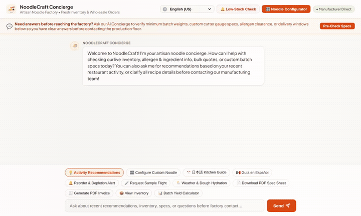

# NoodleCraft Concierge (Artisan Noodle Factory Agent)

An autonomous B2B and consumer AI concierge built with the **Google Agent Development Kit (ADK)** for artisan noodle manufacturers, local restaurants, executive chefs, and grocery wholesale buyers.



---

## What the Agent Actually Does

NoodleCraft Concierge integrates with live Google Cloud enterprise infrastructure to streamline artisan dough formulation, wholesale orders, kitchen dispatch, and inventory intelligence:

- **Artisan Product Catalog & Allergen Transparency**: Queries live noodle varieties (Tokyo Wavy Ramen, Hakata Ultra-Thin, Sanuki Udon, Nagano Ni-Hachi Soba, Bánh Phở, Konjac Shirataki) with real-time flour specs, shelf-life, unit pricing, minimum batch weights, full ingredient lists, and FDA FSMA allergen warnings.
- **Interactive Custom Noodle Engineering**: Evaluates flour blends (Hokkaido wheat, stone-ground buckwheat, duck egg durum, rice flour, konjac), hydration rates (26% - 50%), and cutter gauge geometries (#10, #14, #22, #26, Temomi) to calculate exact boil windows, broth pairings, and chew elasticity.
- **Walk-in Cooler Depletion & Reorder Forecasts**: Analyzes restaurant bowl velocity against delivered batch weights to predict stock run-outs and trigger one-click refrigerated replenishment before factory batch cutoffs.
- **Weather & Dough Hydration Dispatch**: Monitors ambient temperature and humidity to recommend extrusion hydration offsets (e.g., -1.5% water in >70% humidity) and refrigerated transit protocols.
- **Chef Sample Flight Dispatch**: Provisions 3-variety trial kits for executive kitchen testing, logged directly into Firestore with wholesale voucher rebate codes.
- **Commercial PDF Document Generation**: Synthesizes and uploads formal technical specification sheets (with boil curves and allergen boxes) and wholesale Net 15 commercial invoices to Cloud Storage.
- **Order Placement & Batch Logistics**: Creates purchase orders with automatic tiered volume pricing (5%-15% discounts), generates tracking codes, and tracks batch statuses.
- **Appetizing Dish Visualization & Video Generation**: Generates high-resolution dish plating visuals with Imagen 3 and promotional videos using Google Omni models, serving public Cloud Storage URLs directly into the chat stream.
- **Multi-Language Kitchen Support**: Delivers real-time interface localization and technical line-cook guidance in English, Japanese (日本語), Spanish (Español), and Cantonese (繁體中文/粵語).

---

## Wired Google Cloud Services & Architecture

| Service / Component | Status | Implementation Details |
| :--- | :--- | :--- |
| **Google ADK & Gemini 2.5 Flash** | Wired | Powers conversational orchestration, technical parameter calculation, and structured tool routing. |
| **Google Cloud Firestore** | Wired | Primary datastore managing `noodle_products`, `wholesale_orders`, `sample_flights`, and restaurant customer order histories in Native Mode. |
| **Google Cloud Storage (GCS)** | Wired | Public bucket hosting generated dish visual assets, promotional videos, technical PDF spec sheets, and wholesale invoices. |
| **Imagen 3 (`imagen-3.0-generate-002`)** | Wired | Generates custom dish plating concepts and branded wholesale packaging renders uploaded directly to Cloud Storage. |
| **Gemini Omni (`gemini-omni-flash-preview`)** | Wired | Generates high-definition artisan noodle factory and dish preparation video clips uploaded to Cloud Storage and saved to ADK artifacts. |
| **A2UI (Agent-to-User Interface v0.8)** | Wired | Natively formats rich catalog surfaces, ingredient cards, order summaries, and interactive quick links directly in the browser chat stream without third-party frameworks. |
| **Vertex AI Memory Bank** | Planned, not yet implemented | Cross-session memory bank configuration pattern documented; current deployment maintains per-turn conversational context over the A2A protocol. |

---

## Tool Implementations (`app/`)

All registered tools in [`app/agent.py`](app/agent.py):

1. **`list_noodle_products`**: Fetches all active inventory items with flour composition, pricing, ingredients, and allergens from Firestore.
2. **`get_noodle_product`**: Retrieves detailed technical parameters, cooking curves, and storage specs for an individual item.
3. **`calculate_quote_and_discounts`**: Calculates tiered volume wholesale discounts (5%-15%) and order batch totals.
4. **`estimate_delivery_window`**: Calculates refrigerated local freight delivery schedules based on factory batch lead times.
5. **`generate_custom_batch_spec`**: Validates custom flour blends, hydration percentages, and cutter gauges.
6. **`calculate_restaurant_batch_yield`**: Computes portions per kilogram, weekly restaurant batch needs, and cost per plate.
7. **`check_walkin_depletion_and_reorder_reminder`**: Forecasts cooler stock depletion based on average covers/day and triggers reorder reminders.
8. **`get_kitchen_cooking_guide`**: Returns step-by-step commercial kitchen preparation guidelines, boil curves, and strainer handling instructions.
9. **`get_personalized_recommendations`**: Recommends noodle items and broth pairings based on past restaurant order activity.
10. **`request_chef_sample_flight`**: Books a 3-variety evaluation kit for culinary teams and generates a wholesale voucher rebate.
11. **`generate_product_spec_sheet_pdf`**: Generates formal PDF technical spec sheets via ReportLab and uploads to Cloud Storage.
12. **`generate_wholesale_invoice_pdf`**: Generates formal commercial invoices for confirmed orders and uploads to Cloud Storage.
13. **`place_noodle_order`**: Creates confirmed restaurant purchase orders with billing/shipping metadata in Firestore.
14. **`track_order`**: Returns real-time order fulfillment status and scheduled cold-chain delivery dates.
15. **`generate_noodle_dish_image`**: Generates photorealistic dish visual concepts using Imagen 3.
16. **`generate_noodle_video`**: Generates short video clips using `gemini-omni-flash-preview`.
17. **`check_weather_and_dispatch_impact`**: Assesses ambient temperature and humidity for extrusion hydration offsets.
18. **`get_weather` & `get_current_time`**: Real-time factory facility reference utilities.

---

## Project Structure

```
noodlecraft-concierge/
├── app/
│   ├── agent.py               # Main ADK agent definition & registered tools
│   ├── firestore_tools.py     # Firestore inventory, ordering, depletion & yield tools
│   ├── image_tools.py         # Imagen 3 dish and packaging generation
│   ├── video_tools.py         # Gemini Omni video generation
│   ├── pdf_tools.py           # ReportLab commercial spec sheet & invoice PDF builders
│   ├── a2ui_instruction.py    # A2UI catalog prompt and schema guidelines
│   └── a2ui_utils.py          # A2UI response post-processing callback
├── frontend/
│   ├── main.py                # FastAPI proxy with A2A protocol client
│   ├── requirements.txt       # Frontend dependencies (fastapi, a2a-sdk, uvicorn)
│   ├── Dockerfile             # Container definition for Cloud Run
│   └── static/
│       └── index.html         # Responsive web UI with Noodle Configurator & A2UI renderer
├── demo.gif                   # Looping recorded demonstration of the live agent
├── agents-cli-manifest.yaml   # Deployment manifest (ADK, Agent Runtime, A2A)
├── pyproject.toml             # Python dependencies (uv)
└── README.md
```

---

## Running Locally

### Prerequisites
- Python 3.11+
- `uv` package manager installed (`curl -LsSf https://astral.sh/uv/install.sh | sh`)
- Google Cloud SDK (`gcloud`) authenticated with Application Default Credentials:
  ```bash
  gcloud auth login
  gcloud auth application-default login
  ```

### 1. Run the Agent Locally (ADK Web)
To inspect and test the agent directly in the local ADK developer environment:
```bash
uv sync
uv run adk web app
```

### 2. Run the Custom Frontend Locally
The frontend includes the interactive Noodle Configurator, Low-Stock Check, multi-language switcher, and chat box:
```bash
cd frontend
python3 -m venv .venv
source .venv/bin/activate
pip install -r requirements.txt

# Export your Agent Engine resource ID and app directory
export AGENT_ENGINE_RESOURCE_NAME="projects/<PROJECT_ID>/locations/us-central1/reasoningEngines/<RESOURCE_ID>"
export AGENT_DIRECTORY="app"

python main.py
```

---

## Deploying

### Deploy Agent Backend
Deploy the ADK agent to Google Cloud Agent Runtime via the Agents CLI:
```bash
agents-cli deploy
```

### Deploy Frontend to Cloud Run
Build and ship the containerized frontend to Cloud Run with required IAM permissions:
```bash
# Grant the Cloud Run service identity access to invoke the Agent Engine backend
gcloud projects add-iam-policy-binding <PROJECT_ID> \
  --member="serviceAccount:<PROJECT_NUMBER>-compute@developer.gserviceaccount.com" \
  --role="roles/aiplatform.user"

# Deploy the service
cd frontend
gcloud run deploy noodlecraft-frontend \
  --source . \
  --region us-central1 \
  --allow-unauthenticated \
  --set-env-vars AGENT_ENGINE_RESOURCE_NAME="projects/<PROJECT_ID>/locations/us-central1/reasoningEngines/<RESOURCE_ID>",AGENT_DIRECTORY="app"
```
